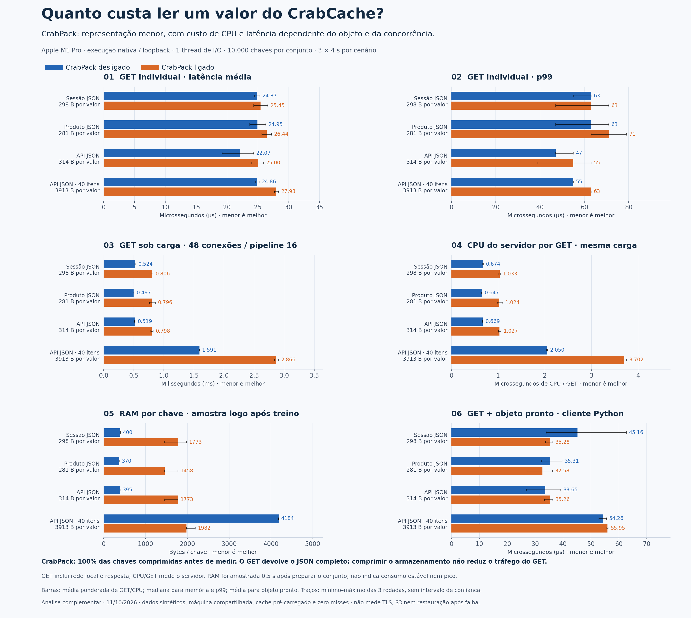
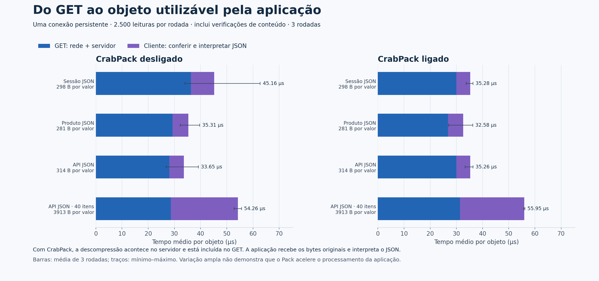
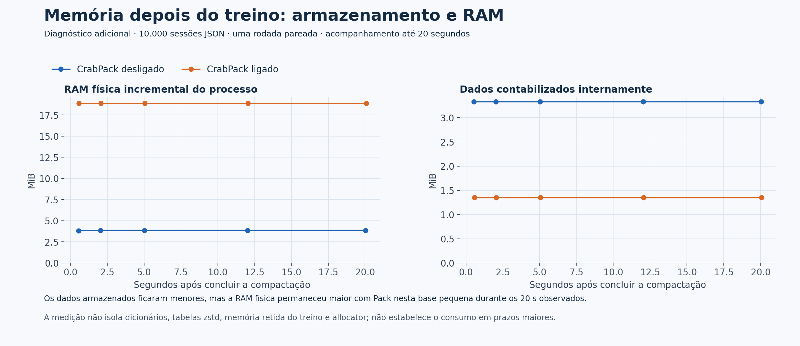

# Leituras do CrabCache: CPU, CrabPack e objetos comprimidos

Análise complementar de **11/10/2026**, mantendo separados os benchmarks auditados de 09/10.
O custo de ler existe com e sem compressão. Com CrabPack, o GET também descomprime o valor.
A aplicação recebe os bytes originais e interpreta o JSON. Compressão não é criptografia.



## Tempos e CPU por objeto

Média de GET em uma conexão, média sob carga de 48 conexões/pipeline 16 e CPU do servidor nessa carga.
As médias de GET e CPU são ponderadas pelo número de respostas de cada rodada.

| Objeto | Valor médio | GET individual sem / com Pack (µs) | GET sob carga sem / com Pack (ms) | CPU sob carga sem / com Pack (µs CPU/GET) | Chaves comprimidas com Pack |
|---|---|---|---|---|---|
| Sessão JSON | 298 B | 24,87 / 25,45 | 0,524 / 0,806 | 0,674 / 1,033 | 100% |
| Produto JSON | 281 B | 24,95 / 26,44 | 0,497 / 0,796 | 0,647 / 1,024 | 100% |
| API JSON | 314 B | 22,07 / 25,00 | 0,519 / 0,798 | 0,669 / 1,027 | 100% |
| API JSON · 40 itens | 3913 B | 24,86 / 27,93 | 1,591 / 2,866 | 2,050 / 3,702 | 100% |

**µs = microssegundo; 1.000 µs = 1 ms.** CPU/GET é trabalho do processo servidor,
não o tempo de espera do cliente. Não use `1 / ops/s` como se fosse latência média.

## Até o objeto ficar pronto na aplicação



O tempo total é medido na mesma requisição: GET + verificações de conteúdo + conversão JSON
no cliente Python. Não soma medições de cargas diferentes.

| Objeto | Sem Pack: GET / processamento / total (µs) | Com Pack: GET / processamento / total (µs) |
|---|---|---|
| Sessão JSON | 36,30 / 8,86 / 45,16 | 29,95 / 5,33 / 35,28 |
| Produto JSON | 29,27 / 6,04 / 35,31 | 26,80 / 5,78 / 32,58 |
| API JSON | 28,07 / 5,58 / 33,65 | 29,95 / 5,31 / 35,26 |
| API JSON · 40 itens | 28,68 / 25,58 / 54,26 | 31,37 / 24,58 / 55,95 |

## Exemplos reais dos objetos sintéticos deste teste

### Sessão JSON · 298 B em média

```json
{
  "user_id": 669727,
  "name": "Olivia Oliveira",
  "email": "olivia.oliveira203@example.com",
  "roles": [
    "user",
    "beta"
  ],
  "locale": "pt-BR",
  "theme": "dark",
  "created_at": "2026-01-22T09:11:21Z",
  "last_seen": "2026-12-22T01:42:26Z",
  "cart": [
    {
      "sku": "SKU-54015",
      "qty": 3
    }
  ],
  "csrf": "dc2ff38f5b19e7ea6ba1da8b62616ea5"
}
```

### Produto JSON · 281 B em média

```json
{
  "id": 3755041,
  "title": "Panela ergonômico slim",
  "price": 2570.21,
  "currency": "BRL",
  "stock": 359,
  "category": "cozinha",
  "tags": [
    "relógio",
    "sem fio",
    "cadeira",
    "mouse"
  ],
  "rating": 2.2,
  "reviews": 18306,
  "updated_at": "2026-11-22T16:42:14Z",
  "seller": {
    "id": 4419,
    "name": "Loja Oliveira",
    "verified": true
  }
}
```

### API JSON · 314 B em média

```json
{
  "request_id": "19b09d355520d6773dfec11db947ea1b",
  "status": 200,
  "data": {
    "items": [
      {
        "id": 795296949,
        "status": "failed",
        "amount": 799.55,
        "at": "2026-08-10T15:16:21Z"
      },
      {
        "id": 731608893,
        "status": "pending",
        "amount": 277.96,
        "at": "2026-08-22T02:09:34Z"
      },
      {
        "id": 642077736,
        "status": "failed",
        "amount": 821.72,
        "at": "2026-04-12T12:45:46Z"
      }
    ],
    "page": 1,
    "has_more": false
  },
  "took_ms": 550
}
```

### API JSON · 40 itens · 3913 B em média

```json
{
  "request_id": "4cf6d80243b288cd48076fccfa120a8f",
  "status": 200,
  "data": {
    "items": [
      {
        "id": 0,
        "status": "ok",
        "amount": 0.0,
        "at": "2026-10-01T12:30:00Z",
        "category": "casa"
      },
      {
        "id": 1,
        "status": "pending",
        "amount": 0.07,
        "at": "2026-10-02T12:30:00Z",
        "category": "moda"
      }
    ],
    "page": 1,
    "has_more": false
  },
  "took_ms": 1,
  "nota_do_relatorio": "Mostrados 2 dos 40 itens; o teste usa todos."
}
```

## Onde a eficiência aparece

O benefício direto do CrabPack é reduzir a memória do armazenamento. Descomprimir usa CPU
e pode aumentar a latência ou limitar o throughput. O GET continua transmitindo o valor original:
a compressão interna não é uma compressão do protocolo de rede.
Valores maiores também exigem mais cópia/transmissão e mais trabalho para interpretar JSON.

## Memória: representação menor não garante menos RAM numa base pequena

No ensaio de 10 mil chaves, o footprint logo após o treino foi maior com Pack para os três
conjuntos pequenos. Na página de API com 40 itens, a amostra ficou menor com Pack.
Os valores comprimidos ocupam menos bytes internos, mas a RAM física inclui outros custos.



Uma verificação adicional pareada de sessões acompanhou os dois servidores até 20 segundos
após concluir a compactação. A contabilização interna caiu com Pack, mas o footprint permaneceu
maior durante todo o período observado. Não foi apenas uma diferença que desapareceu após 2 segundos.
Esta verificação tem uma rodada, não três, e não isola a contribuição de dicionários, tabelas zstd,
memória retida do treino e comportamento do allocator. Não permite concluir quanto tempo esses custos persistem.

A auditoria anterior tinha **300 mil chaves**, e mostrou redução de footprint com CrabPack nesses
JSONs maiores em volume. Portanto, a quantidade de chaves e os custos fixos importam:
não extrapole a economia da base grande para toda base pequena. Compare RAM física, não só `used_memory`.

## Método e limites

- Apple M1 Pro; macOS-26.6.2-arm64-arm-64bit; 10 CPUs lógicas; 16 GiB.
- CrabCache 0.3.0 nativo, build release; hash SHA-256 do binário: `b8f79633735f30523e1afc32a0ce3b4a8c8cad4b23e37297ddd9b4318b3750a8`.
- Python `3.10.5`; memtier conforme metadados.
- 10,000 chaves por conjunto, 3 rodadas de 4 segundos por condição; ordem dos servidores e das cargas invertida na segunda rodada.
- Uma instância nova por conjunto/servidor/rodada; servidor com uma thread de I/O, sem afinidade a núcleo.
- Cliente e servidor compartilham o Mac, por loopback; outros aplicativos continuam ativos.
- Leituras GET aleatórias: 1 cliente sem pipeline; ou 4 threads × 12 conexões, pipeline 16.
- Cache pré-carregado. Zero erros de carga e exatamente N respostas; DBSIZE=N; zero misses.
- JSON: todas as chaves comprimidas antes de medir Pack.
- Conferência de todas as chaves após cada carga de GET, fora do intervalo medido.
- Memória física: footprint do macOS final menos baseline, dividido por N; mediana de três amostras por rodada.
- Memória coletada antes das leituras de validação completa; espera de 0,5 s após preparar a compressão. Não mede pico de treino.
- CPU: diferença do tempo cumulativo de todo o processo, via `ps time`, dividida pelos GETs contabilizados pelo cliente.
- CPU inclui threads auxiliares e o trabalho em segundo plano do CrabPack. A resolução de `ps time` limita a precisão.
- Medição de objeto pronto: 2.500 GETs por rodada, uma conexão Python persistente, acesso aleatório e aquecimento de 100 requisições.
- Média: acumulado de latências / contagem total. p99: mediana dos p99 das rodadas, não percentil global agrupado.
- Traços no gráfico indicam mínimo–máximo observado, não intervalos de confiança.
- Este ensaio é curto e usa conjuntos menores que a auditoria anterior. Não misture números como se fossem a mesma carga.
- Não mede S3, disco, restauração após reiniciar, recuperação de backup, TLS nem o tempo isolado de uma função zstd.
- Estes dados sintéticos não garantem latência ou economia para objetos de produção.

## O que os benchmarks anteriores já mostravam

Sessões JSON de aproximadamente 297 B, 300.000 chaves, 48 conexões e três rodadas de 10 segundos.
Médias recalculadas a partir de `Accumulated Latency / Count` nos JSONs publicados.

| Pipeline | GET médio sem / com Pack (ms) | p99 sem / com Pack (ms) | CPU sem / com Pack (µs CPU/GET) |
|---|---|---|---|
| 1 | 0,374 / 0,410 | 0,511 / 0,575 | 7,690 / 8,390 |
| 16 | 0,670 / 1,050 | 1,007 / 1,439 | 0,860 / 1,331 |

[Auditoria publicada](../../BENCHMARKS.md).

## Reproduzir e conferir

O código da aplicação não foi alterado para este ensaio. Os scripts desta pasta geram
novos artefatos locais, preservando os benchmarks publicados.

```bash
python3 -m venv --system-site-packages target/analysis-venv
target/analysis-venv/bin/python -m pip install matplotlib
SECS=4 REPEATS=3 KEYS=10000 target/analysis-venv/bin/python docs/analises/leituras-crabpack-2026-10-11/medir.py
KEYS=10000 target/analysis-venv/bin/python docs/analises/leituras-crabpack-2026-10-11/memoria.py
# Cada script anuncia seu diretório novo. Use os caminhos entre aspas:
target/analysis-venv/bin/python docs/analises/leituras-crabpack-2026-10-11/graficos.py "CAMINHO-DA-MEDICAO" "PASTA-DOS-GRAFICOS" "CAMINHO-DA-MEMORIA/summary.json"
```

`graficos.py` verifica contagens, erros, misses, cobertura de compressão, hashes dos conjuntos,
latências a partir dos JSONs brutos, fórmulas de CPU/memória e decomposição do tempo do cliente.

Artefatos brutos desta execução: `docs/benchmark-results/2026-10-11-read-analysis`.

[Dados agregados CSV](dados-conferidos.csv) · [Dados e metadados JSON](dados-conferidos.json) ·
[Gráfico vetorial](comparacao-leituras.svg) · [PDF](comparacao-leituras.pdf)
